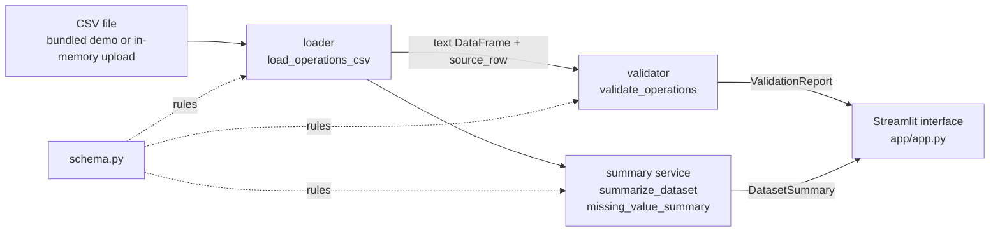

# Architecture (foundation milestone v0.1.0)

## Components

| Component | Location | Responsibility |
| --- | --- | --- |
| Schema | `src/agriflight/data/schema.py` | Single definition of columns, required/optional values, record types and date format. Used by every other component. |
| Loader | `src/agriflight/data/loader.py` | Reads a CSV (path, bytes or file object) as text; keeps IDs and blanks exactly; adds `source_row`; raises `DataLoadError` with a readable message for empty, missing, non-UTF-8 or unparseable files. Never writes. |
| Validator | `src/agriflight/data/validation.py` | Applies the data-contract rules and returns a `ValidationReport` with an issue table (`source_row`, `field`, `issue_code`, `severity`, `raw_value`, `explanation`). Never drops, fills or edits rows. |
| Summary service | `src/agriflight/services/data_summary.py` | Read-only descriptive figures: rows per record type, distinct units/clients, valid date ranges per record type, blank-value summary. |
| Project status | `src/agriflight/services/project_status.py` | Versioned text describing what is implemented, pending, and undecided. |
| Interface | `app/app.py` | Streamlit presentation: data-source choice, four views, filters. Contains no validation or business rules. |
| Tests | `tests/` | Unit tests for loader, validator and summaries; headless Streamlit smoke test. |

## Data flow

CSV -> loader -> validator -> summary service -> interface. The validator and
summary service both consume the loader's output independently; neither
mutates it.

## Why the UI is separate from processing

- **Testability:** every rule is a plain Python function tested with pytest,
  without starting a browser or Streamlit.
- **Replaceability:** the proposal's later "Python API" layer and any future
  UI can call the same package functions; Streamlit can be swapped out.
- **Honesty of output:** the UI cannot invent a rule or a label - it can only
  display what the tested services return.
- **Privacy:** the processing functions accept in-memory bytes, so uploads
  never need to touch the filesystem.

## Design decisions

- All values are read as text; parsing happens in separate `*_parsed`
  columns so the original value is always available to explain an issue.
- Blank is distinct from invalid. Whether a blank is a problem depends on the
  field and record type (see the data contract).
- Record types are never merged when counting.

## Future extension points (PLANNED - not implemented)

| Extension | Notes |
| --- | --- |
| `agriflight.adapters` - private workbook adapter | Maps the private staging tables onto reviewed schemas; run locally only; requires approved mappings and source precedence. |
| `agriflight.ledger` - completed-service event ledger | Needs the completion rule (multi-day captures), service episodes and onboarding dates. |
| `agriflight.cadence` - cadence evaluation | 30-day target, +/-5-day tolerance, once the anchor and eligible periods are confirmed. |
| `agriflight.models` - coverage prediction | Baseline first, then ML (proposal 3.2), chronological splits. |
| `agriflight.scheduling` / routing | OR-Tools based scheduling and routing (proposal 3.3). |
| API layer | Thin Python API over these services (proposal 3.5). |
