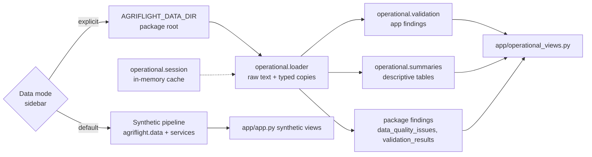
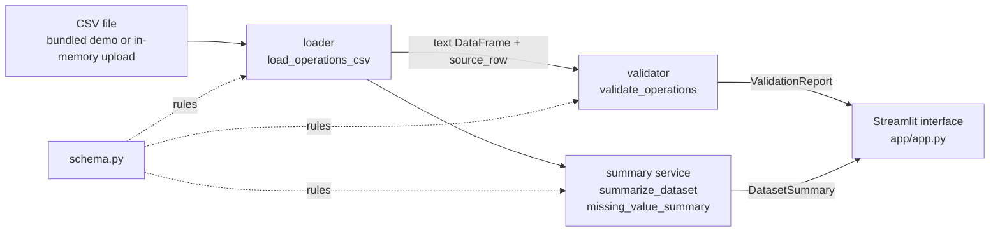

# Architecture (v0.2.0)

The application has two explicit data modes that share one interface shell:

- **Synthetic demonstration (default):** the v0.1.0 components below, on the
  public nine-column demo CSV.
- **Private operational dataset:** read-only views over the private
  integrated package, located at run time through `AGRIFLIGHT_DATA_DIR`.
  See [operational_dataset.md](operational_dataset.md) for tables, join rules
  and budget safeguards.

Private-mode components:

| Component | Location | Responsibility |
| --- | --- | --- |
| Contract | `src/agriflight/operational/contract.py` | Columns, types, keys, foreign keys and allowed values the app depends on. |
| Loader | `src/agriflight/operational/loader.py` | Locates and checks the package; reads CSVs read-only; strict parsing; template recognition. |
| Validation | `src/agriflight/operational/validation.py` | Application findings, kept separate from the package's supplied findings. |
| Summaries | `src/agriflight/operational/summaries.py` | Descriptive tables with no-inflation and no-allocation counting safeguards. |
| Session cache | `src/agriflight/operational/session.py` | Per-session, in-memory only. Reloads when files change; cleared on return to synthetic mode. |
| Views | `app/operational_views.py` | Rendering and labelling only. |
| EDA | `src/agriflight/operational/eda.py` | Completeness, unit history, gaps between recorded capture dates, area evidence, overlap summary. |
| Coverage feasibility | `src/agriflight/operational/coverage.py` | Target-source eligibility, exclusion reasons, training status, feature-availability review. |
| EDA report | `src/agriflight/operational/eda_report.py` | Builds results for both the view and the script; validates the private output folder and writes outputs plus run metadata. |
| Baseline | `src/agriflight/baselines/baseline.py` | Guarded historical-mean baseline (single grain, verified targets, chronological split). Not fitted to operational data. |
| Script | `scripts/run_eda.py` | Reproducible private EDA run (see [eda_methodology.md](eda_methodology.md)). |

Scheduling baseline components (see [scheduling_baseline.md](scheduling_baseline.md)):

| Component | Location | Responsibility |
| --- | --- | --- |
| Input contracts | `src/agriflight/scheduling/contracts.py` | Scenario folder loader and validator (jobs, bundles, resources, availability, locations, directed travel, cost rates). |
| Rule baseline | `src/agriflight/scheduling/rule_baseline.py` | Deterministic greedy day-by-day, bundle-by-bundle rule; route simulation; unassigned-job diagnosis. |
| Costs | `src/agriflight/scheduling/costs.py` | Itinerary cost estimates by explicit rate level; unknown rates stay unknown. |
| Checker | `src/agriflight/scheduling/checker.py` | Independent validation of assignments, resources, continuity, time, hard constraints and cost arithmetic. |
| Outputs | `src/agriflight/scheduling/outputs.py` | Tables shared by the app view and the script. |
| View / script | `app/scheduling_view.py`, `scripts/run_schedule.py` | Synthetic-mode tab; command-line runs (private scenarios kept outside Git). |
| Demo scenario | `examples/scheduling_demo/` | Entirely fictional inputs plus their generator. |

## Synthetic-mode components (v0.1.0, unchanged)

| Component | Location | Responsibility |
| --- | --- | --- |
| Schema | `src/agriflight/data/schema.py` | Single definition of columns, required/optional values, record types and date format. Used by every other component. |
| Loader | `src/agriflight/data/loader.py` | Reads a CSV (path, bytes or file object) as text; keeps IDs and blanks exactly; adds `source_row`; raises `DataLoadError` with a readable message for empty, missing, non-UTF-8 or unparseable files. Never writes. |
| Validator | `src/agriflight/data/validation.py` | Applies the data-contract rules and returns a `ValidationReport` with an issue table (`source_row`, `field`, `issue_code`, `severity`, `raw_value`, `explanation`). Never drops, fills or edits rows. |
| Summary service | `src/agriflight/services/data_summary.py` | Read-only descriptive figures: rows per record type, distinct units/clients, valid date ranges per record type, blank-value summary. |
| Project status | `src/agriflight/services/project_status.py` | Versioned text describing what is implemented, pending, and undecided. |
| Interface | `app/app.py` | Streamlit presentation: data-source choice, four views, filters. Contains no validation or business rules. |
| Tests | `tests/` | Unit tests for loader, validator and summaries; headless Streamlit smoke test. |

## Data flow

CSV -> loader -> validator -> summary service -> interface. The validator and
summary service both consume the loader's output independently; neither
mutates it.

## Why the UI is separate from processing

- **Testability:** every rule is a plain Python function tested with pytest,
  without starting a browser or Streamlit.
- **Replaceability:** the proposal's later "Python API" layer and any future
  UI can call the same package functions; Streamlit can be swapped out.
- **Honesty of output:** the UI cannot invent a rule or a label - it can only
  display what the tested services return.
- **Privacy:** the processing functions accept in-memory bytes, so uploads
  never need to touch the filesystem.

## Design decisions

- All values are read as text; parsing happens in separate `*_parsed`
  columns so the original value is always available to explain an issue.
- Blank is distinct from invalid. Whether a blank is a problem depends on the
  field and record type (see the data contract).
- Record types are never merged when counting.

## Future extension points (PLANNED - not implemented)

| Extension | Notes |
| --- | --- |
| Further operational tables | Area evidence, planned schedules, trials and daily-work evidence are not yet shown (read-only integration exists for 18 tables). |
| `agriflight.ledger` - completed-service event ledger | Needs the completion rule (multi-day captures), service episodes and onboarding dates. |
| `agriflight.cadence` - cadence evaluation | 30-day target; operational +/-5 vs proposal +/-3 kept distinct; only once the anchor and eligible periods are confirmed. |
| Coverage prediction models | Historical-mean baseline implemented (not fitted); ML (proposal 3.2) blocked until verified daily-hectare targets exist. |
| OR-Tools scheduling and routing | Planned (proposal 3.3); to be compared with the rule-based baseline on identical scenarios using the shared cost and checker modules. |
| API layer | Thin Python API over these services (proposal 3.5). |
